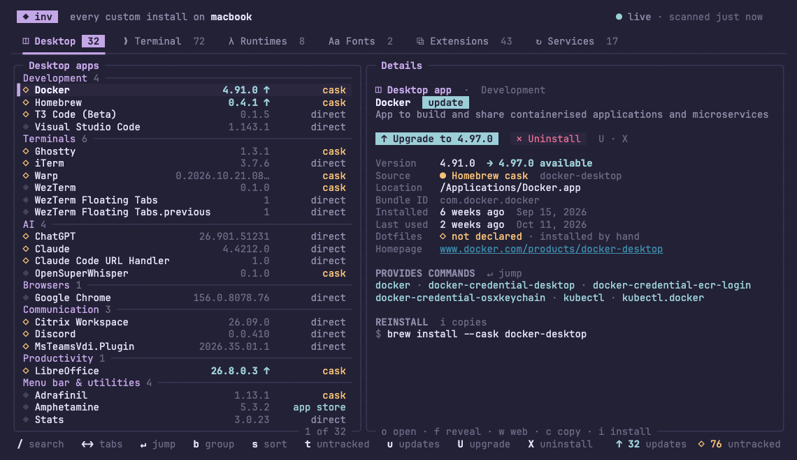

<div align="center">
  

  <h1>inv</h1>

  <p><strong>See every app, command-line tool, and runtime you installed on your Mac, in one live terminal view.</strong></p>

  <p>
    inv finds custom installs across Homebrew, the App Store, npm, uv, vendor installers, and hand-copied binaries.
    It separates desktop apps from terminal tools, flags drift from your dotfiles, upgrades or removes things with the right package manager, and updates as you install and remove things.
  </p>

  <p>
    <a href="#quick-start">Quick start</a> ·
    <a href="#preview">Preview</a> ·
    <a href="#how-it-works">How it works</a> ·
    <a href="#development">Development</a>
  </p>
</div>

## Quick start

You need macOS and either Nix with flakes or Go 1.26+.
Homebrew, `mas`, and `npm` are optional; inv uses them when they are installed.

Run it straight from GitHub with Nix:

```sh
nix run github:dboyza/inv
```

Or build from a checkout, with `nix develop -c go build -o inv .` or plain `go build -o inv .`, then run `./inv`.
The first scan takes a few seconds, then six tabs appear with counts for desktop apps, terminal tools, runtimes, fonts, extensions, and services.
Later launches paint instantly from a cache in `~/Library/Caches/inv/` and refresh in the background.

inv only changes your system when you confirm an upgrade or uninstall.
In the background it checks for updates over the network with `brew outdated --greedy`, `mas outdated`, and `npm outdated -g`, and it runs `--version` on standalone binaries that have no other version source.

For scripting, `./inv --json` prints the full inventory and exits.

## Preview

<p align="center">
  <a href="docs/assets/screenshot.png"></a>
</p>

## How it works

inv collects raw observations from each install source in parallel, then classifies them into one normalized list.

- **Desktop and terminal stay separate.** Each kind gets its own tab, accent color, and purpose groups such as AI agents, Cloud & infra, or Terminals.
- **Every row shows where it came from.** Source badges distinguish brew, cask, App Store, npm, uv, dotfiles, vendor installers, and manual copies.
- **Apps and their CLIs are linked.** Commands that ship inside an app, like `docker` in Docker.app, show `via Docker`, and Enter jumps between them.
- **Drift is visible.** ◆ marks items your dotfiles declare, ◇ marks hand installs, and ✗ marks declared items that are missing.
- **Upgrade and uninstall in place.** Buttons in the details pane run the owning package manager, such as `brew upgrade --cask` or `npm uninstall -g`, after a confirmation that shows the exact command.
  Upgrades run in the background, one at a time, while you keep browsing.
- **It stays current.** A file watcher rescans only the affected sources and announces installs, removals, and upgrades as they happen.

The details pane adds versions and available updates, install and last-used dates, zsh history run counts, commands shared between installs, dangling links, and a reinstall command.

Upgrades and uninstalls take over the terminal so you see live output and can answer Touch ID or `sudo` prompts; inv returns when the command finishes.
Items no package manager owns, such as direct-download apps or hand-copied binaries, move to the Trash, where Finder's Put Back restores them.
inv refuses to remove things it cannot do safely, such as CLIs bundled inside an app, dotfiles-managed tools, and system installs, and explains why instead.
Press `E` to export every untracked install as snippets for `nix/homebrew.nix` and `nix/macos-apps.json`, plus commented lists of what no package manager can reproduce.

Dotfiles drift reads `nix/homebrew.nix`, `nix/macos-apps.json`, and `scripts/managed-tools.json` from a Nix dotfiles repository.
inv finds the repository by following Home Manager links such as `~/.zshrc`, or you can set `INV_DOTFILES` to its path.
Without one, drift markers are hidden.

<details>
<summary>Keyboard and mouse</summary>

| Keys | Action |
| --- | --- |
| `←` `→` `tab` `1`-`6` | Switch tabs (or click a tab) |
| `↑` `↓` `j` `k` `g` `G` | Move through the list (or scroll and click) |
| `/` | Fuzzy search across every tab |
| `enter` | Jump between an app and its bundled CLIs; opens details on narrow screens |
| `b` / `s` | Group by purpose, source, or nothing; sort by name, newest, or last used |
| `t` / `u` / `d` | Show only untracked, only updatable, or include brew dependencies |
| `U` / `X` | Upgrade or uninstall the selected item (or click its button), after confirming |
| `E` | Export untracked installs as dotfiles snippets |
| `o` `f` `w` | Open the app, reveal in Finder, open the homepage |
| `c` / `i` | Copy the path or the reinstall command |
| `r` / `R` | Rescan now, recheck updates |
| `?` | Full help |

</details>

## Development

```text
package-tui/
├── main.go             Flags, --json output, program start
├── internal/inv/       Discovery and classification, no UI
│   ├── snapshot.go     Collector groups, parallel scans, cache
│   ├── build.go        Snapshot to display items: drift, links, updates
│   ├── catalog.go      Curated purpose groups and descriptions
│   ├── ops.go          Upgrade and uninstall plans per source
│   └── watch.go        Debounced filesystem watching
├── internal/ui/        Bubble Tea model, views, keys, Rose Pine theme
├── docs/assets/        Logo and screenshot
├── flake.nix           Nix package and a dev shell that pins Go
└── AGENTS.md           Conventions for contributors and coding agents
```

Run the checks from the repository root:

```sh
nix develop -c go vet ./...
nix develop -c go test ./...
```

## Next steps

- **Use it:** press `?` inside inv for every shortcut, or pipe `./inv --json` into `jq` for scripts.
- **Change it:** read [AGENTS.md](AGENTS.md) for the architecture boundary, catalog conventions, and verification steps.
- **Report a problem:** include your macOS version, the install source involved, and the matching entry from `./inv --json`.
